# LG webOS 1 TV Hub

> **Experimental hobby project.** Not affiliated with, endorsed by, or supported by LG Electronics or Anthropic.

One app for an old LG smart TV (webOS 1.x, 2014–2015) with Developer Mode. It runs inside the TV and gives you:

- a **phone remote** (keys, touchpad, typing, app shortcuts),
- a **Claude assistant** that controls the TV in plain language ("open BBC One", "what is on tonight?", "today's top news"),
- a fast **Home Screen** with app tiles, what is on now, and an answer screen for the assistant,
- a **health monitor** and a **scheduler** (reminders, lower the volume at night, free memory),
- **party games**: the TV is the game screen and every phone is a controller (up to 8 players, guests need no access code).

Everything runs in one service and one TV app. After a TV restart you open one app, and the phone uses one address.

<p align="center">
  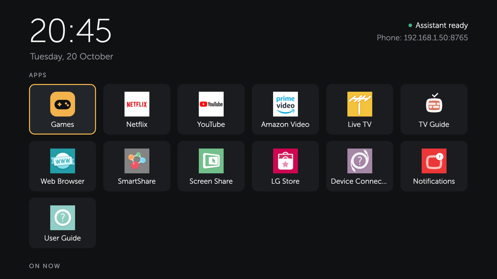
</p>

**Status:** experimental. Tested on an LG 47LB652V (webOS 1.4.0): the remote, the assistant, the Home Screen, the health monitor and the five games.

## Quick start

You need a computer with Node.js 22 or later, on the same network as the TV.

1. Pair with the TV: `node tools/pair.js 192.168.1.50` ([details](docs/01-find-and-pair.md)).
2. Turn on Developer Mode and run `TV_IP=192.168.1.50 scripts/setup-devmode.sh` ([details](docs/02-developer-mode.md)).
3. Install: `TV_IP=192.168.1.50 scripts/deploy.sh` ([details](docs/03-install-on-the-tv.md)).
4. On the phone, open `http://192.168.1.50:8765`. Type the **setup PIN** that the Home Screen shows next to the phone address, choose an access code (6-32 characters), and add the page to the phone's home screen.
5. For the assistant: **Settings** tab, **Claude**, save your Anthropic API key.

## The phone page

One page with three tabs, at `http://<tv-ip>:8765`.

| 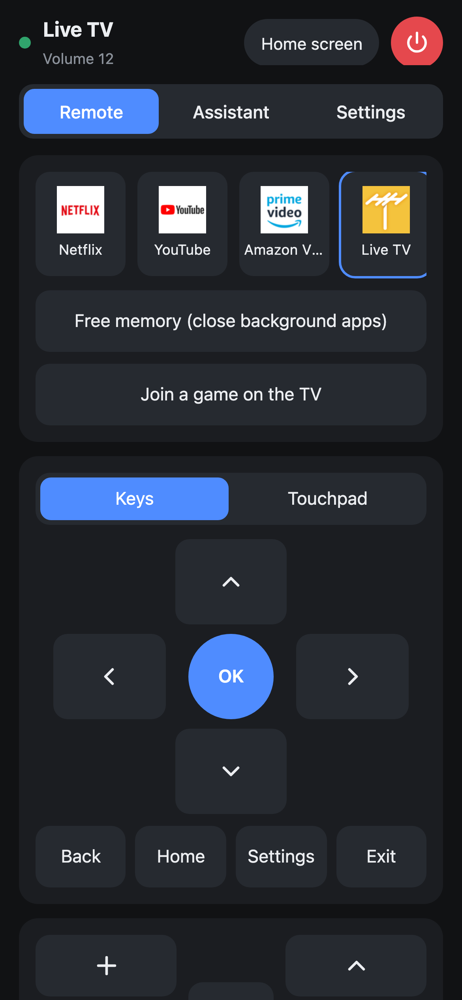 | 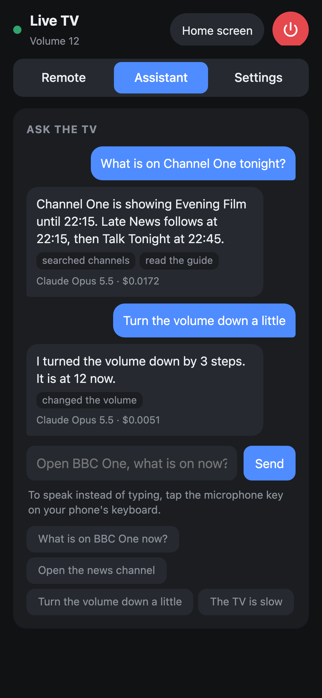 | 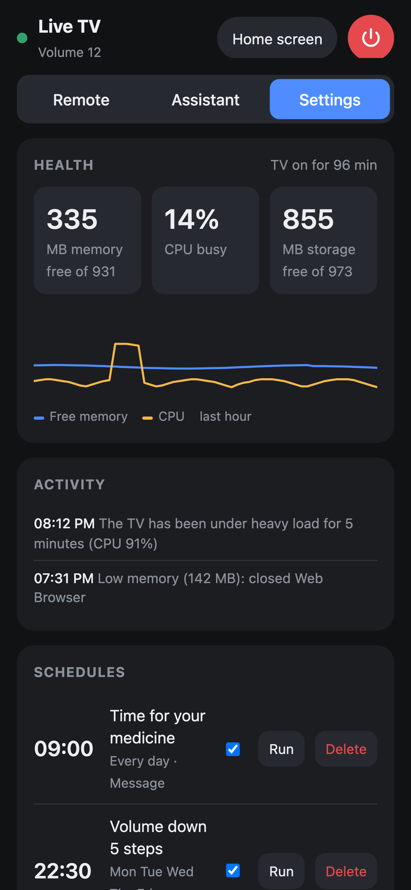 |
| --- | --- | --- |
| Remote | Assistant | Settings |

- **Remote:** app shortcuts (hold a tile to remove another app installed with `scripts/deploy-app.sh` under the `com.lgtvfastest.` id prefix), Free memory, arrow keys or touchpad, Back, Home, volume, channel, media keys, Type on TV, number and color keys. The power button and **Home screen** sit at the top of every tab.
- **Assistant:** type a request, or use the microphone key of the phone keyboard to speak.
- **Settings:** health, activity, schedules, health rules, and the Claude settings (API key, model, effort, limits, show on TV, web search).
- The access code protects everything. The phone remembers it.

## The Home Screen

| 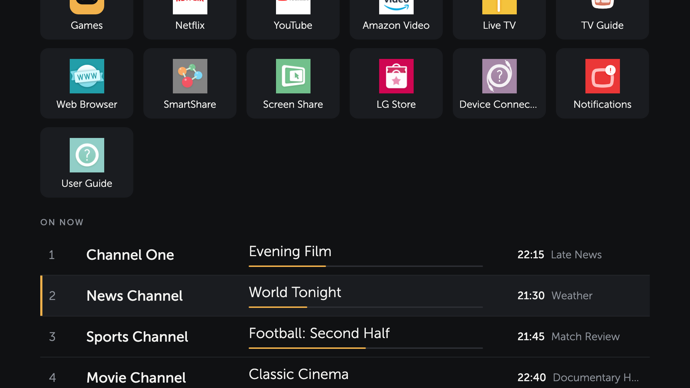 | 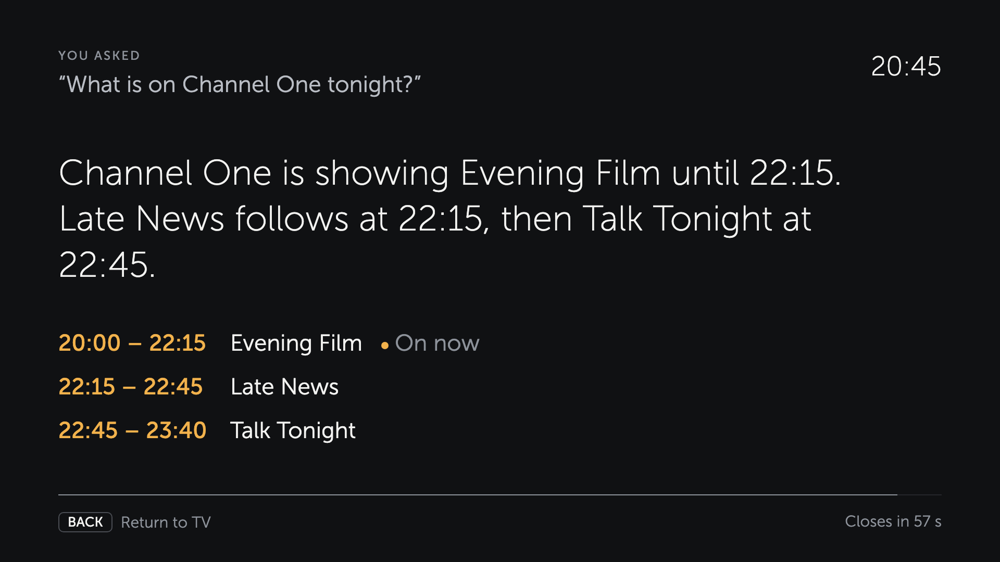 |
| --- | --- |
| Apps and what is on now | Answer screen |

- Arrows move between the app tiles and the channel rows. **OK** opens an app or switches to the channel. Opening an app closes background apps first, so it starts faster.
- **On now** shows four channels: the one you watch first, then the lowest-numbered TV channels. The TV gives guide data only while Live TV is on screen, so the hub reads the guide then and keeps the next 24 hours.
- When an assistant answer is a program guide list or a web search result, the Home Screen comes to the front with it. **Back**, or 60 seconds, returns to the app that was on screen. Other answers show as a short message on the TV.

## Games

| 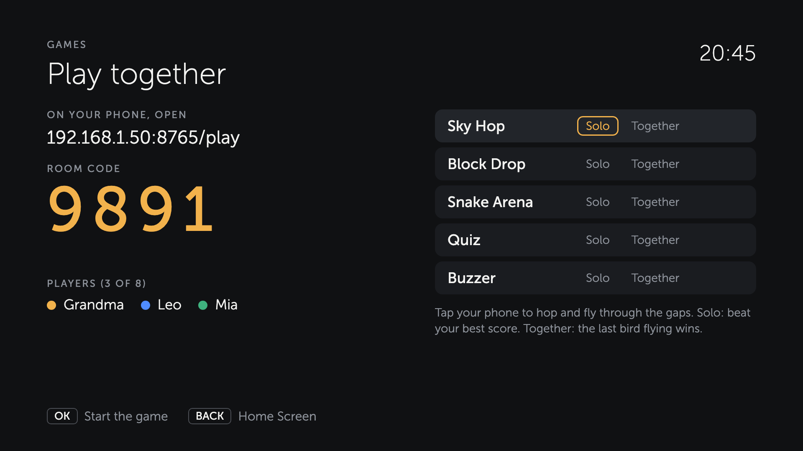 | 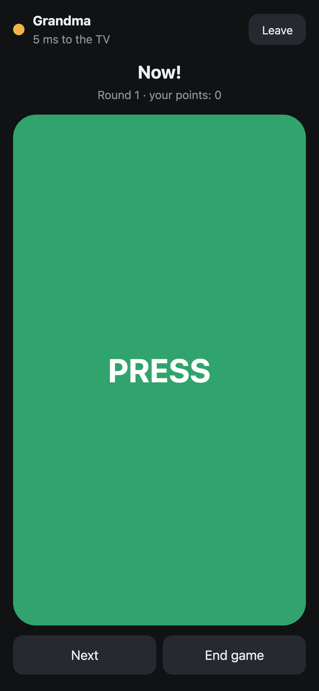 | 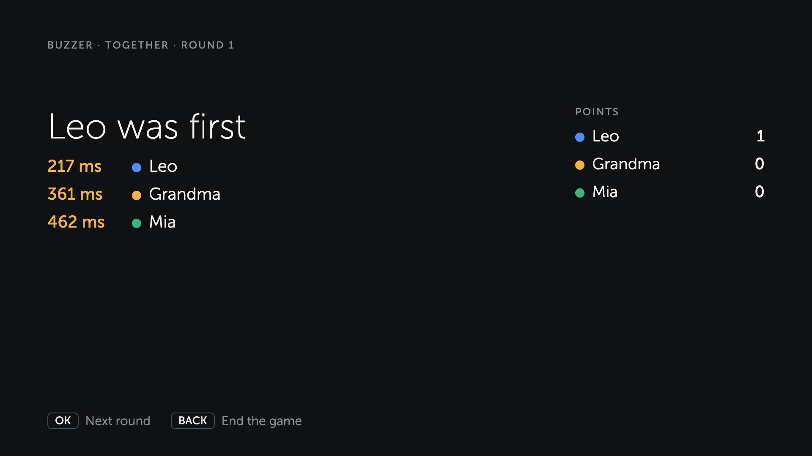 |
| --- | --- | --- |
| Games screen on the TV | Phone controller | Result on the TV |

| 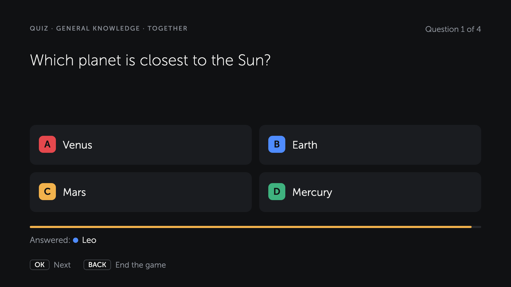 | 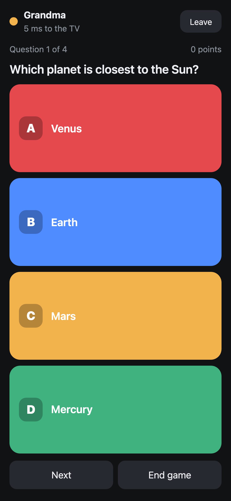 |
| --- | --- |
| Quiz on the TV | Quiz on the phone |

| 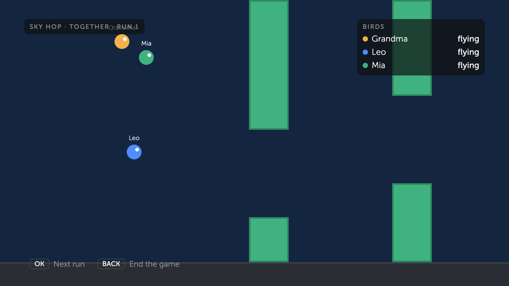 | 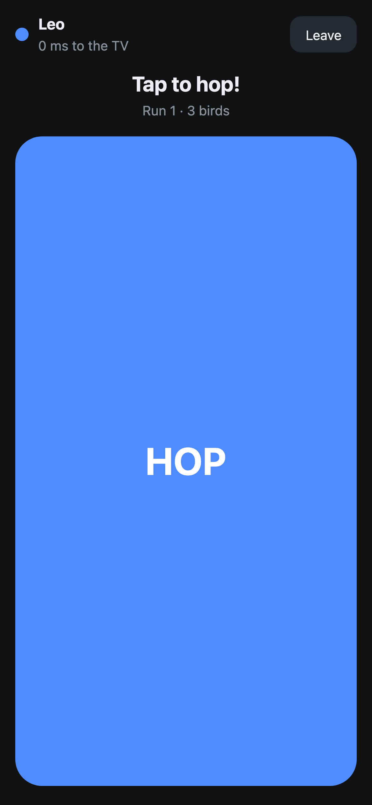 |
| --- | --- |
| Sky Hop on the TV | Sky Hop on the phone |

| 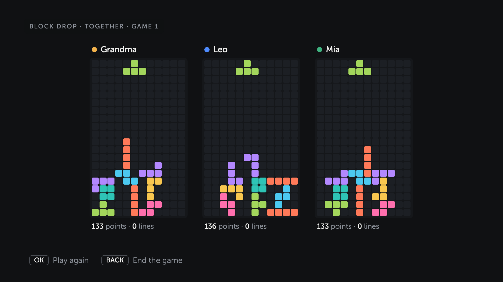 | 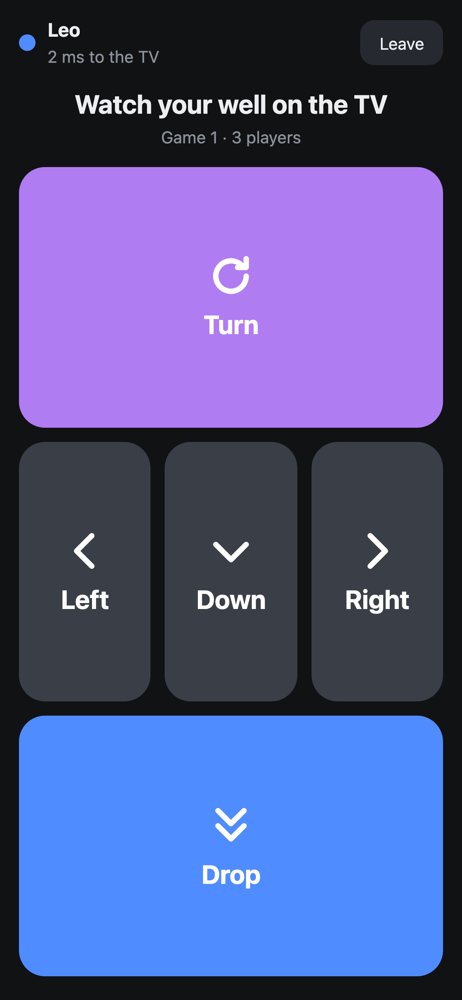 | 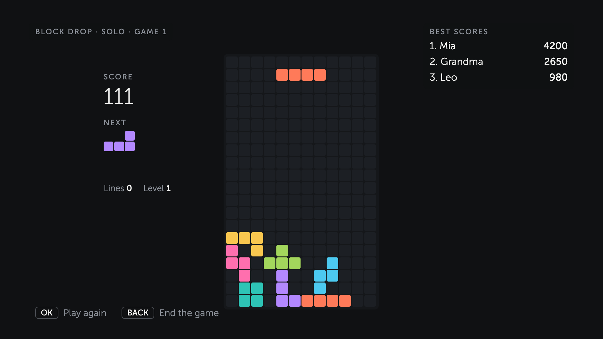 |
| --- | --- | --- |
| Block Drop, Together | Block Drop on the phone | Block Drop, Solo |

| 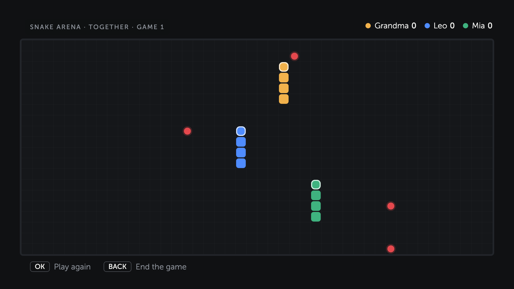 | 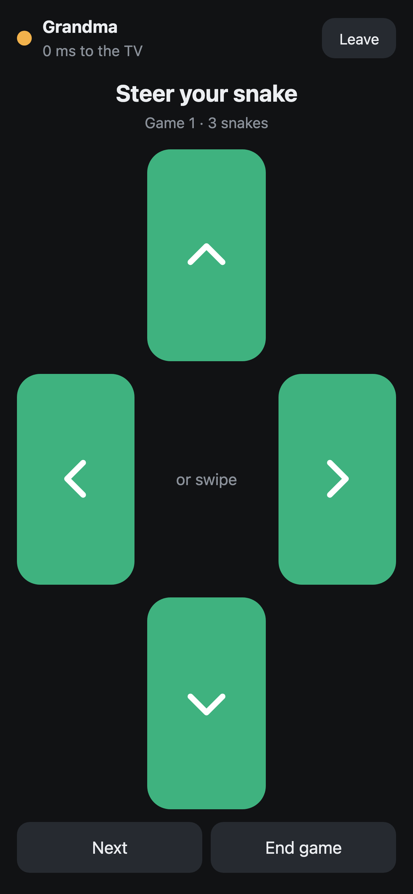 |
| --- | --- |
| Snake Arena on the TV | Snake Arena on the phone |

1. On the Home Screen, open the **Games** tile. The TV shows an address and a room code.
2. Each player opens `http://<tv-ip>:8765/play` on a phone (the **Remote** tab has a link too), types the code and a name.
3. The first player is the host: the host's phone picks the game, the topic and **Solo** or **Together**, and has **Next** and **End game** buttons. The TV remote works too (**OK** starts, **Back** ends).

| Game | Solo | Together |
| --- | --- | --- |
| **Sky Hop** | Tap the phone to hop through the gaps; beat your best score | One bird per player in the same sky; the last bird flying wins |
| **Block Drop** | Turn and drop falling blocks to clear lines; it gets faster every 10 lines; beat your best score | Up to 4 wells side by side with the same pieces; clearing 2 or more lines at once sends junk rows to the others; the last one in wins. With more than 4 players, those who sat out play next |
| **Snake Arena** | Eat apples; the snake gets longer and faster; beat your best score | Up to 8 snakes on one board; walls, bodies and head-on hits end a snake; the last one in wins |
| **Quiz** | Claude writes the questions in the host phone's language; beat your best score (records count 8-question games) | Everyone answers on the phone; the most points wins |
| **Buzzer** | Press when the TV says GO; beat your best time | The fastest press wins the round |

- Quiz choices on the host phone: one of 8 topics, **Surprise me** (Claude picks the topic), or **your own topic** in your own words (for example "90s songs"); difficulty (mixed, easy, medium, hard); 5, 8 or 12 questions. From the TV remote: general knowledge, mixed, 8 questions, in the TV's language.
- Points in the quiz: 100 for a right answer plus up to 100 for speed. After each question the TV shows the answer and a short fact.
- Solo records (best scores and times) stay on the TV. In Solo the other phones watch.
- Sounds are made with Web Audio on the TV and on the phones (no sound files): GO, right and wrong answers, the last 5 seconds, a new record.
- Sky Hop, Block Drop and Snake Arena run in real time: the game runs on the TV page, the hub sends each button press to the TV at once and keeps the standings from what the TV reports. They are made to stay light on this TV: Sky Hop moves a few elements (about 46 frames a second), Block Drop recolors only the cells that changed, and Snake Arena moves only the tail of each snake to the new head place, about 8 steps a second. The TV lobby has one row per game; left and right pick Solo or Together.
- Measured on the TV: Claude Sonnet 5.5 wrote 8 questions in Turkish in 11 seconds, for about $0.01 a game. The quiz counts toward the daily request limit.

New games plug into the same room system; see [How games work](docs/04-how-it-works.md#how-games-work).

Each phone keeps one WebSocket to the hub; the TV Games screen uses HTTP long-polls, because the TV's web engine stops opening WebSockets after a while. The game logic runs on the hub; the TV and the phones only draw what it sends. The game page cannot use the remote, the power button or the settings. Only the TV itself can open or close a room; the host phone can start, skip and stop games.

## The assistant

The hub sends the request to Claude, runs the tools Claude asks for on the TV, and returns the answer.

| Tool | What it does on the TV |
| --- | --- |
| `tv_status` | App on screen, volume, current channel |
| `find_channel` | Searches the channel list (ignores case, spaces, punctuation and accents) |
| `open_channel` | Switches channel; opens Live TV first if needed |
| `channel_guide` | Now and next programs of a channel |
| `list_apps`, `open_app` | Lists and opens apps |
| `volume` | Up, down, mute |
| `show_message` | A message on the TV screen |
| `free_memory` | Closes background apps |
| `web_search` | News, weather and facts; runs on Anthropic's side (on/off in Settings, at most 3 searches a request) |

Turning the TV off is not a Claude tool on purpose; it stays a scheduler action and a phone button.

**Cost** (measured with Claude Opus 5.5 on the TV): a channel guide question about $0.017, a volume change about $0.005, a news question with one web search about $0.11 (the search results add many input tokens; web search itself is $10 per 1,000 searches). A daily request limit stops runaway cost; also set a spend limit in the Anthropic Console.

**How it calls the API:** raw HTTPS from Node.js 0.10 (the SDK needs a modern Node.js); one stable system prompt and tool list with prompt caching; strict tool schemas; server-side refusal fallback on Opus and Sonnet; append-only history; all tool results of a turn in one message.

## Health monitor and scheduler

| 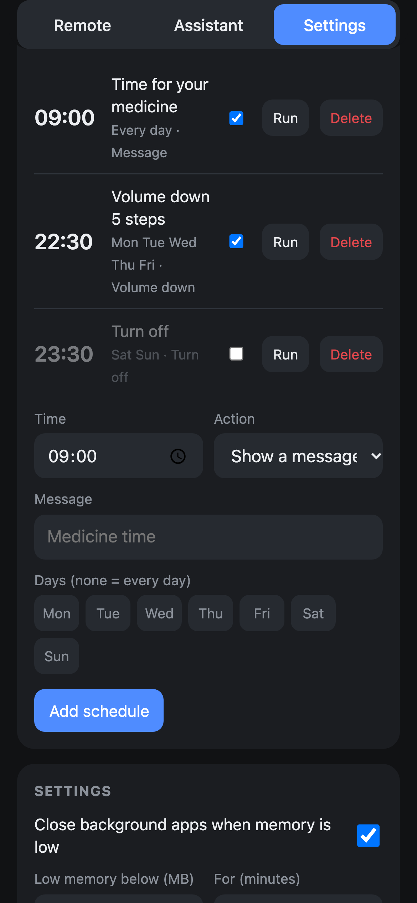 | 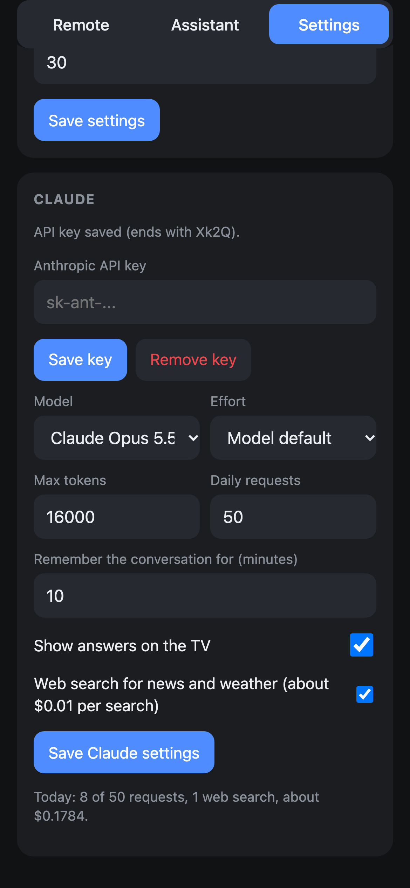 |
| --- | --- |
| Schedules | Claude settings |

- **Health monitor** (every minute): free memory and CPU, the last hour, free storage. When memory stays low it closes background apps and tells you on the TV. When the CPU stays busy for minutes it warns you; the TV gives no temperature, so long high load is the only sign of heat.
- **Scheduler:** tasks at a time of day, on chosen weekdays: show a message, free memory, lower the volume, turn the TV off. A task missed while the TV was off does not run late.

The screenshots show the real pages with sample data (generic channel names, a fixed clock). `node tools/screenshots.js` makes them again.

## Limits of webOS 1.4

- **No start after a restart:** Developer Mode services cannot start themselves. Open **Home Screen** once after the TV turns on; schedules resume then.
- **Developer Mode expires:** press **Extend Session Time** in the Developer Mode app regularly, or the apps disappear.
- **Guide data only with Live TV on screen** (see above). A guide question from another app switches to Live TV.
- **No TV microphone and no browser speech recognition** (the page is plain HTTP); the phone keyboard's dictation works.
- **Old root certificates:** the TV's Node.js trusts its built-in certificates, which expire in January 2028. The assistant may stop reaching the API then.

## Security

- The phone page and the API need the access code (6-32 characters). Only the Home Screen app needs none: the service gives it a token that web pages cannot get, so a page in the TV's own browser is treated like any other device.
- The first access code needs the setup PIN that the Home Screen shows, so only someone who can see the TV sets it.
- Ten wrong codes or PINs from one address lock that address out for ten minutes; other phones and the Home Screen keep working.
- The hub answers only requests for its own address (no DNS rebinding), accepts only JSON in POST requests, and sends no open CORS headers. The games' WebSocket accepts only pages served by the hub.
- The access code and the API key travel over plain HTTP on the home network. Use the hub only on a network you trust.
- The API key stays on the TV, in the hub's settings file. The page shows only its last four characters. It is never logged or committed.
- `.tv_key` (pairing key) and `.devmode/` (SSH key and tools) are in `.gitignore`. The pairing key enters only the installed package.
- Remote commands check every argument (known keys, known apps, text up to 200 characters, bounded touchpad moves). Only Developer Mode apps with the `com.lgtvfastest.` id prefix can be removed, and never the Home Screen.
- Games: a phone joins only with the room code on the TV screen (20 wrong codes a minute from one address stop joins from that address for a while; players who rejoin with their token are not affected), and can only send game input (the host phone can also start, skip and stop games). A quiz calls Claude once per start, so a room allows one quiz request at a time, 30 seconds between starts and 20 starts, on top of the daily limit. Messages, frames and the number of connections are limited, a connection that does not say who it is within 5 seconds is closed, and a client that stops reading is dropped.

## Files

| Path | Job |
| --- | --- |
| `apps/home/` | Home Screen app (`com.lgtvfastest.home`) |
| `services/home/` | Hub service (`com.lgtvfastest.home.service`), Node.js 0.10 |
| `static/phone.html` | Phone page |
| `static/play.html`, `static/games/` | Phone game page and the phone part of each game |
| `apps/home/games.html`, `apps/home/games/` | TV Games screen and the TV part of each game |
| `services/home/games.js`, `services/home/games/` | Game rooms and the game logic |
| `services/home/wsserver.js` | WebSocket server for the games |
| `scripts/setup-devmode.sh` | One-time Developer Mode setup on the computer |
| `scripts/deploy.sh`, `scripts/deploy-app.sh` | Build and install on the TV |
| `tools/pair.js` | Pairs with the TV, writes `.tv_key` |
| `tools/tls-check.js` | Checks that the TV's Node.js can reach the Anthropic API |
| `tools/screenshots.js` | Renders the screenshots from the real pages with sample data |
| `tests/` | Tests for the game rooms, the games and the server (`node tests/run.js`) |

## Tests

```bash
node tests/run.js
```

The tests run on a computer with Node.js 22 or later and need no packages. They cover the access rules (setup PIN, access code, Home Screen token, lockout, Host and CORS checks), the game rooms, every game's rules, the TV parts of Block Drop and Snake Arena (in a small fake page), the TV screen's long-polls, the TV control client against fake TVs, and the real server with phones on WebSockets. They do not reach a TV.

The code that runs on the TV must stay ES5 (Node.js 0.10 and WebKit 537). To check it:

```bash
npx acorn@8.14.0 --ecma5 --silent services/home/*.js services/home/games/*.js apps/home/*.js apps/home/games/*.js
```

## Docs

1. [Find the TV and pair](docs/01-find-and-pair.md)
2. [Turn on Developer Mode](docs/02-developer-mode.md)
3. [Install on the TV](docs/03-install-on-the-tv.md)
4. [How it works](docs/04-how-it-works.md)
5. [webOS 1 pitfalls](docs/05-webos1-pitfalls.md)
6. [Troubleshooting](docs/06-troubleshooting.md)
7. [What the TV allows](docs/features.md)

## License

MIT, see [LICENSE](LICENSE).
