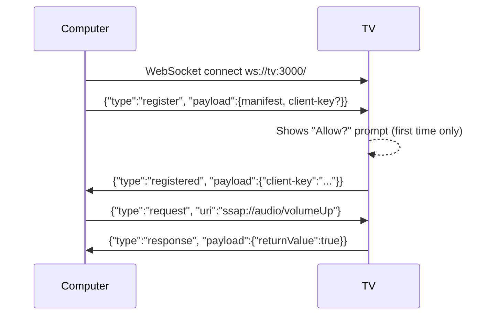

# 1. Find the TV and pair

This step connects a computer to the TV over the home network. The install step needs the pairing key it makes.

## Find the TV address

1. On the TV, open **Settings > Network** and read the IP address. It looks like `192.168.1.50`.
2. Check that the computer can reach the TV:

   ```bash
   nc -z 192.168.1.50 3000 && echo "TV control port is open"
   ```

Port 3000 is the TV's control port (SSAP, see below). If it is closed:

- The TV is off or in standby. Turn it on.
- The TV is on another network, such as a guest Wi-Fi. Put it on the same network as the phone and the computer.
- **LG Connect Apps** (or **Mobile TV On**) is off. Turn it on in the TV network settings, if your model has it.

**Tip:** Give the TV a fixed IP address in your router (a "DHCP reservation"). Otherwise the router can give the TV a new address one day, and the phone page bookmark stops working.

## Find the model and webOS version (optional)

The pairing tool below prints the TV model. The webOS version is visible only with Developer Mode (see step 2): `cat /var/run/nyx/os_info.json`.

## What SSAP is

SSAP (Simple Service Access Protocol) is how LG's own phone apps control the TV. It is JSON over a WebSocket on port 3000:



The first registration shows a prompt on the TV. After you accept it, the TV returns a **client key**. Later connections send that key and skip the prompt.

## Pair

You need Node.js 22 or later on the computer.

```bash
node tools/pair.js 192.168.1.50
```

1. A prompt appears on the TV. Accept it with the TV remote.
2. The tool prints `Paired with <model>`.
3. The key is now in `.tv_key`. Keep this file private: it gives control of the TV.

Next: [Turn on Developer Mode](02-developer-mode.md).
