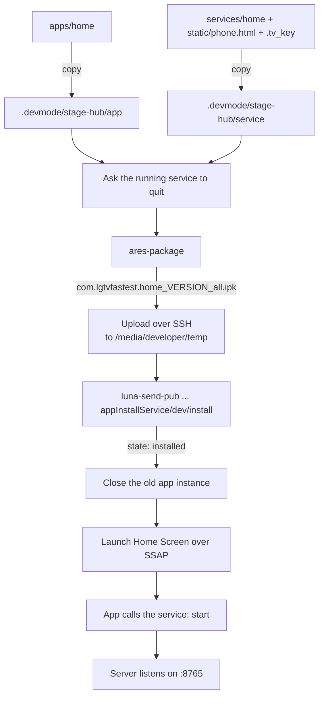

# 3. Install on the TV

This step installs one package with two parts:

- **Home Screen** (`apps/home`): a web app with a clock, app tiles, what is on now, and the answer screen of the assistant.
- **Hub service** (`services/home`): a Node.js service with the phone remote, the Claude assistant, the health monitor and the scheduler. It listens on port 8765.

## Before you start

- [Paired with the TV](01-find-and-pair.md): `.tv_key` exists.
- [Developer Mode set up](02-developer-mode.md): `ssh -F .devmode/ssh_config lgtv` works.

## Install

```bash
TV_IP=192.168.1.50 scripts/deploy.sh
```

The script prints `"state": "installed"` and opens **Home Screen** on the TV. On the phone, open `http://192.168.1.50:8765`.

The first time, the phone page asks you to choose an access code. Anyone who opens the page later needs it, to use the remote or to change settings. The phone remembers it.

## What the deploy script does



1. **Stage:** It copies the app and the service into `.devmode/stage-hub`. The phone page and the pairing key go into the service. The key is never in Git; it enters only the package.
2. **Stop the old service:** A running service keeps its old code. The script calls the service's built-in `quit` method.
3. **Package:** `ares-package` (from the LG CLI) builds one `.ipk` file with the app and the service.
4. **Upload:** The package goes to `/media/developer/temp` on the TV over SSH.
5. **Install:** The TV's install service (`com.webos.appInstallService/dev/install`) installs the package. The script waits until it reports `installed`.
6. **Close, then launch:** A hidden app keeps its old page, and a launch only brings it back. So the script closes the app, waits, and opens **Home Screen** over SSAP. The app calls the service's `start` method, and the service starts the HTTP server.

You can install any other web app the same way:

```bash
TV_IP=192.168.1.50 scripts/deploy-app.sh apps/<name> [services/<name>]
```

## Use it every day

| Task | How |
| --- | --- |
| Open the phone page | `http://<tv-ip>:8765` (add it to the home screen of the phone) |
| Open a tab directly | `http://<tv-ip>:8765/#remote`, `#assistant`, `#settings`, or `#touchpad` |
| Open the Home Screen on the TV | Phone: **Home screen** at the top. TV remote: **Home** button, then **Home Screen** |
| Open an app or a channel on the TV | Home Screen: arrows, then **OK** on a tile or on a row under **On now** |
| After the TV restarts | Open **Home Screen** once; this starts the hub |
| Read the hub log | Over SSH: `curl -s -H 'X-Access-Code: <your code>' http://127.0.0.1:8765/api/logs` |
| Remove another app you installed with `scripts/deploy-app.sh` (id prefix `com.lgtvfastest.`) | Phone, **Remote** tab: hold its tile, then confirm |
| Play a game | TV: **Games** tile. Phones: `http://<tv-ip>:8765/play` and the room code |

**Tip:** Move **Home Screen** to the front of the TV's app bar. Then **Home** and **OK** open it.

## Type on the TV with the phone keyboard

The TV's on-screen keyboard is slow. Use the phone instead, for web addresses, searches and sign-in names:

1. On the TV, select the text box (with the arrow keys and **OK**, or with the touchpad).
2. In the **Remote** tab, scroll down to **Type on TV**.
3. Type the text with the phone keyboard and press **Send**. The message **Sent to the TV** confirms it.
4. Press **Enter** to submit, or **Delete** to remove the last character.

The text goes from the phone to the TV over your home network only.

## Remove everything

1. Remove **Home Screen** from the TV app bar.
2. In **Developer Mode**, turn off **Dev Mode Status**. The TV restarts and closes the SSH port.

Next: [How it works](04-how-it-works.md).
