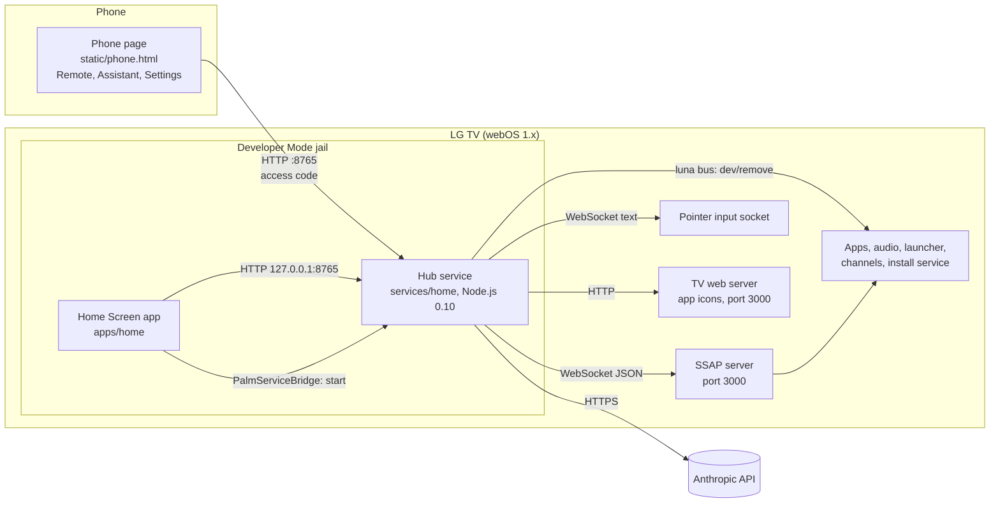
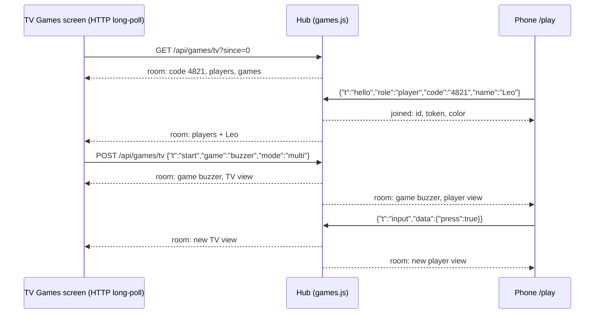

# 4. How it works

## The big picture



The **hub service** is the center. It turns simple commands from the phone into SSAP requests, sends requests in plain language to Claude, watches memory and CPU, and runs timed tasks. The phone and the Home Screen app never talk to the TV system directly.

## The pieces

| Piece | File | Runs in | Job |
| --- | --- | --- | --- |
| Phone page | `static/phone.html` | Phone browser | Remote keys, touchpad, typing; assistant chat; health, schedules and settings |
| Home Screen | `apps/home/index.html` | Home Screen app on the TV | Clock, app tiles, what is on now, answer screen |
| Service | `services/home/service.js` | TV, Node.js 0.10 | Starts the server, keeps it alive, removes apps |
| Server | `services/home/server.js` | TV, Node.js 0.10 | HTTP routes, access code, TV actions, answer hand-off |
| Remote | `services/home/remote.js` | TV, Node.js 0.10 | App list, icons, keys, touchpad, typing, memory cleanup |
| Assistant | `services/home/agent.js`, `claude.js`, `tools.js` | TV, Node.js 0.10 | Claude tool loop, API client, TV tools |
| Guide cache | `services/home/guidecache.js` | TV, Node.js 0.10 | Reads the program guide while Live TV is on |
| Health, scheduler | `services/home/health.js`, `scheduler.js` | TV, Node.js 0.10 | Memory, CPU, storage; timed tasks |
| Settings | `services/home/store.js` | TV, Node.js 0.10 | One JSON file in the first writable folder |
| SSAP client | `services/home/ssap.js` | TV, Node.js 0.10 | WebSocket client, pairing, requests, pointer socket |

## HTTP API

The phone page and the Home Screen use the same API. Every `/api` call needs the header `X-Access-Code`, except calls from the Home Screen app, which send its token in `X-Hub-Token` (see above). Ten wrong codes or PINs from one address in ten minutes lock that address out for ten minutes. The server answers only requests whose `Host` is one of the TV's own addresses or `localhost`, and accepts only `Content-Type: application/json` in POST requests.

| Method | Path | Body or query | Result |
| --- | --- | --- | --- |
| GET | `/` | | Phone page |
| GET | `/api/status` | | `accessCodeSet`, `authorized` (no code needed) |
| POST | `/api/access` | `{"code": "...", "pin": "..."}` | Sets the first code (6-32 characters) with the setup PIN from the Home Screen; changing it needs the current code |
| GET | `/api/icon` | `?id=<appId>` | App icon (PNG) from the TV (no code needed: an image cannot send the header) |
| GET | `/api/state` | | Connection, app list, app on screen, volume |
| POST | `/api/cmd` | `{"cmd": "...", "arg": ...}` | Runs one remote command |
| GET | `/api/health` | | Memory, CPU, storage, last hour, activity, next tasks, page address; for the Home Screen also the setup PIN until a code exists |
| GET, POST | `/api/settings` | `{"health": {...}, "ai": {...}}` | Health and Claude settings |
| GET, POST | `/api/schedules` | `{"time", "days", "action", "text", "steps"}` | List or add timed tasks |
| POST | `/api/schedules/enable`, `/run`, `/delete` | `{"id", ...}` | Turn a task on or off, run it now, delete it |
| POST | `/api/ask` | `{"text": "..."}` | Claude's answer, the tools it used, model, usage, cost |
| POST | `/api/ask/reset` | | Forget the conversation |
| POST | `/api/apikey`, `/api/apikey/delete` | `{"key": "sk-ant-..."}` | Save or remove the API key |
| GET | `/api/usage` | | Today's requests, web searches and estimated cost |
| GET | `/api/now` | | What is on now and next on the cached channels |
| GET | `/api/answer` | | The answer for the answer screen (for two minutes) |
| POST | `/api/answer/close` | `{"id"}` | Close the answer and go back to the app that was on screen |
| GET | `/api/logs` | | Last 300 log lines |
| GET | `/play` | | Phone game page (no code needed) |
| GET | `/games/<id>.js` | | Phone part of a game (no code needed) |
| GET (upgrade) | `/ws` | | WebSocket for the phone game page; see below |
| GET, POST | `/api/games/tv` | `?since=N` / `{"t": "start", ...}` | The TV Games screen: room state (long-poll) and commands (TV only) |
| POST | `/api/log` | `{"message": "..."}` | The Home Screen reports a script error |

Commands for `/api/cmd`:

| `cmd` | `arg` | What happens on the TV |
| --- | --- | --- |
| `launch` | app ID | Closes background apps, then opens the app |
| `button` | key name, e.g. `UP`, `ENTER`, `BACK` | Remote key over the pointer socket |
| `move`, `scroll` | `{"dx": 10, "dy": -4}` | Cursor move or scroll |
| `click` | | Click at the cursor |
| `text`, `backspace`, `enter` | text | Typing into the focused text field |
| `volumeUp`, `volumeDown`, `channelUp`, `channelDown`, `play`, `pause` | | Audio, channel and media control |
| `freeMemory` | | Closes background apps |
| `openHome` | | Opens the Home Screen app |
| `openChannel` | channel ID from `/api/now` | Opens Live TV if needed, then switches to the channel |
| `uninstall` | app ID | Removes an app this project installed |
| `powerOff` | | Turns the TV off |

The server checks every argument: unknown keys, unknown apps and text over 200 characters get HTTP 400.

## Three channels to the TV

### 1. SSAP requests (most commands)

A request is one JSON message on the SSAP WebSocket. Examples:

| Command | SSAP URI |
| --- | --- |
| Open an app | `ssap://system.launcher/launch` with `{"id": "netflix"}` |
| Volume up | `ssap://audio/volumeUp` |
| App on screen | `ssap://com.webos.applicationManager/getForegroundAppInfo` |
| App list | `ssap://com.webos.applicationManager/listLaunchPoints` |
| Type text | `ssap://com.webos.service.ime/insertText` |

The service keeps one connection open and reconnects when needed. Requests sent while it reconnects wait for the connection.

### 2. Pointer input socket (keys, cursor)

Remote keys and the cursor do not use SSAP requests. The service first asks SSAP for a second socket:

```
ssap://com.webos.service.networkinput/getPointerInputSocket  ->  {"socketPath": "ws://.../netinput.pointer.sock"}
```

Then it sends plain text frames on that socket:

```
type:button      type:move       type:click      type:scroll
name:UP          dx:12           (empty line)    dx:0
(empty line)     dy:-4                           dy:6
                 down:0
                 (empty line)
```

The touchpad sends many small moves. The phone page adds them up and sends one request at a time, and HTTP keep-alive reuses one connection. Twenty moves take about 0.3 seconds.

### 3. The luna bus (remove apps)

The service is a real webOS service, so it can call system services on the luna bus. Removing an app uses `luna://com.webos.appInstallService/dev/remove`. This works only for apps that Developer Mode installed.

## How "Free memory" works

webOS 1 keeps apps in memory after you leave them. The TV has about 930 MB of RAM, and one web app can use more than 300 MB.

`ssap://system.launcher/close` closes an app, but webOS 1 asks for the **session ID** that the launch returned. The session ID is only Base64 of `"<appId>:undefined"`:

```
base64("netflix:undefined") = "bmV0ZmxpeDp1bmRlZmluZWQ="
```

So the service builds the ID for every app in the list and sends `close` to each one. A `500` error means "not running". It keeps the app on screen, Live TV and Home Screen.

## How the service stays alive

A webOS JavaScript service normally exits 5 seconds after its last request. The `webos-service` library on the TV runs that timer. The service turns it off:

```js
service.activityManager._stopTimer();
service.activityManager.exitOnTimeout = false;
```

Now the HTTP server keeps running after the Home Screen app closes. It stops only when the TV restarts.

## How the Home Screen app talks to the service

The app runs from a `file://` page inside the TV's web app manager.

1. On load, it calls the service's `start` method through `PalmServiceBridge`, the luna bridge that every webOS web app has (`apps/home/hub.js`). The answer has a token that the service makes when it starts.
2. It then calls the server at `http://127.0.0.1:8765` with the token in the `X-Hub-Token` header. Web pages cannot call the luna bridge, so a page in the TV's browser, which also connects from 127.0.0.1, has no token and needs the access code like any phone.
3. The page is a `file://` page (Origin `null`). The server allows CORS only for that origin, and the app has `allowCrossDomain` in its `appinfo.json`.
4. A restarted service has a new token. A request that gets 401 or 403 asks for the token again and is sent once more.
5. While the service starts after a TV restart, the page retries for about 20 seconds.

## How an answer reaches the TV screen

1. A request from the phone goes to Claude. If Claude read the program guide or searched the web, and did not open a channel or an app, the answer is a list or a longer text.
2. The server keeps that answer for two minutes and opens **Home Screen** over SSAP.
3. The Home Screen asks `/api/answer` every 1.5 seconds and shows the answer screen.
4. **Back**, or 60 seconds, closes it. The server then opens the app that was on screen before, but only while Home Screen is still in front.

Other answers stay a short message (toast) on the TV.

## Why "On now" needs Live TV

The TV answers program guide requests only while Live TV is on screen. So the guide cache reads the guide while Live TV is on (every 30 minutes, and when the channel changes) and keeps the next 24 hours: the channel being watched first, then the lowest-numbered TV channels. The Home Screen shows it later.

## How games work



- **Phones: one WebSocket each** (`/ws`, `services/home/wsserver.js`). The hub has no npm packages, so it handles the WebSocket handshake and frames itself (text only, 4 KB a message).
- **The TV Games screen: HTTP long-polls** (`GET /api/games/tv?since=N` answers when the room changes or after 20 seconds; `POST /api/games/tv` sends `start`, `stop`, `host` (next round or question) and `close`). On webOS 1.4 the web engine stops sending WebSocket handshakes after a while (the TCP connection opens, the handshake never comes) until the TV is unplugged, while plain HTTP keeps working.
- **One room at a time:** the TV Games screen opens it, with a 4-digit code. Only a connection from the TV itself may open or close the room. The host phone (the first connected player) and the TV remote start, skip and stop games. Games that call Claude allow one request at a time, 30 seconds between starts and 20 starts per room. Up to 8 players. A phone that reconnects (screen lock, reload) sends its token and keeps its name, color and points. The room closes when you press **Back** in the TV lobby, or about three minutes after the TV screen stops polling (45 seconds to notice, then 2 minutes to come back).
- **The hub runs the game.** The TV and the phones send input and draw the views they get back after every change. So a game cannot be different on two screens, and a phone cannot cheat by changing its page.

### Add a game

A game is three small files with the same id:

| File | Runs on | Job |
| --- | --- | --- |
| `services/home/games/<id>.js` | Hub, Node.js 0.10 (ES5) | Rules and state. Exports `id`, `title`, `description`, `modes` (`["solo", "multi"]`), optional `topics`, and `create(api)`; the instance has `start()`, `onInput(player, data)`, `onHost(data)`, `tvView()` and `playerView(player)`. `api` gives `mode`, `lang`, `topic`, `players()` (in Solo only the host), `update()`, `later(fn, ms)`, `records(key)`, `saveRecord(key, entry, lowerIsBetter)`, `ask(request, cb)` (one Claude request with a JSON schema) and `log(msg)`. |
| `apps/home/games/<id>.js` | TV, WebKit 537 (ES5) | Sets `window.TVGAMES[id] = { render(box, view), okText }`, plus `onEvent(event)` for games that run on the TV. |
| `static/games/<id>.js` | Phone | Sets `window.GAMES[id] = { render(box, view, send, me) }`. |

**Games that run on the TV.** A real-time game (Sky Hop) cannot wait for the hub on every frame, so its physics run in the TV part. The hub part sends each tap to the TV at once with `api.tvEvent(event)` (the TV gets it in the next long-poll answer and calls `window.TVGAMES[id].onEvent(event)`), and the TV part reports what happened with `window.TVHub.report(data)`, which reaches the hub part as `onTvReport(data)`. The hub part still owns the run, the standings and the records, and checks every report (the run number, a player in the run, a score in range). Random parts use a seed from the hub, so a run looks the same however the page draws it (in Block Drop every well gets the same pieces).

The hub part of these games is shared: `services/home/games/tvrun.js` runs the countdown, the runs, the standings and the records, so a new real-time game only says which phone input it takes. Block Drop's hub part is the whole example:

```js
module.exports = tvrun.make({
  id: "blocks", title: "Block Drop", description: "...", maxPlayers: 4,
  input: function (data) { return MOVES.indexOf(data.move) >= 0 ? { move: data.move } : null; }
});
```

The TV report is `{ run, crashes: [{ id, score }], over, final: [{ id, score }], scores }`: players out in the same report share a place, and `over` ends the run (nobody is left, or one player is left and wins; `final` has that player's score, and `crashes` lists everyone who is out, in case an earlier report was lost). Every 10 seconds `scores` brings the scores of the players still in, so a run that reaches the 15-minute limit ends with real scores. A phone can send at most 25 inputs a second. When there are more players than places (Block Drop has 4 wells), the players who have played the fewest runs play first. `apps/home/games/kit.js` (`window.TVKit`) has the shared TV parts: the countdown, the final screen, the best scores list and the seeded random numbers.

Then add the hub module to the `GAMES` list in `services/home/games.js`, and a `<script src="games/<id>.js">` line to `apps/home/games.html` (after `games/kit.js` if the game uses it). Timers made with `api.later` stop when the game ends. Sounds: `TVSound.play(name)` on the TV (`apps/home/sound.js`) and `PhoneSound.play(name)` on the phone (`static/sound.js`), both made with Web Audio. On webOS 1.4 `<audio>` files start 1-3 seconds late and `decodeAudioData` cannot read MP3, so the sounds are generated.

## Written for an old engine

| Place | Engine | Rules |
| --- | --- | --- |
| Home Screen app | WebKit 537.41 (web app manager) | ES5 only, no flexbox or grid, `XMLHttpRequest` instead of `fetch` |
| Service | Node.js 0.10.15 | ES5, callbacks, `new Buffer()` |
| Phone pages | Any modern phone browser | Modern JavaScript and CSS |

Next: [webOS 1 pitfalls we hit](05-webos1-pitfalls.md).
